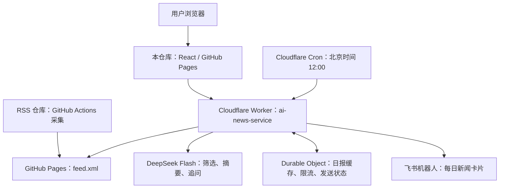

# AI 新闻助手

面向 AI 从业者的新闻阅读与对话应用：从 RSS 全文中筛选每日资讯，用 DeepSeek 生成分级摘要，支持围绕新闻继续追问，并在每天北京时间 12:00 将日报推送到飞书。

[](https://yhao-l.github.io/ai-news-assistant/)
[](https://github.com/Yhao-L/ai-news-assistant/actions/workflows/deploy.yml)
[](https://react.dev/)
[](LICENSE)

**[打开在线应用](https://yhao-l.github.io/ai-news-assistant/)** · **[RSS 与后端源码](https://github.com/Yhao-L/aibase_news_rss)** · **[后端部署说明](https://github.com/Yhao-L/aibase_news_rss/tree/main/worker)**

> 当前版本已迁移到 RSS + DeepSeek + Cloudflare Workers，模型统一使用 `deepseek-flash`。线上入口不再依赖 Coze；历史播客与旧推送页面已退出当前产品入口。

## 产品逻辑

AI 新闻更新频繁，逐条阅读和判断价值需要时间。本项目把“获取资讯、筛选重点、理解新闻、定时送达”串成一条流程，同时提供两个使用入口：

| 入口 | 用户体验 |
| --- | --- |
| 网页对话 | 查询每日新闻、阅读带原文链接的摘要，围绕技术名词、事件与影响继续追问，也支持简单聊天 |
| 飞书日报 | 每天北京时间 12:00 自动发送交互卡片，不需要打开网页或保持本地电脑运行 |

两个入口复用同一套日报生成服务。网页聊天不会触发飞书发送，当天首次生成的日报会缓存复用。

可以在网页中尝试：

- “今天有什么重要 AI 新闻？”
- “第一条新闻里的 MoE 是什么意思？”
- “这项技术对产品开发有什么影响？”

## 核心能力

- **全文新闻处理**：从 [AIbase RSS](https://yhao-l.github.io/aibase_news_rss/feed.xml) 读取完整正文，过滤最近 24 小时文章并去重。
- **分级筛选与总结**：按配置的提示词筛选技术进展、模型发布及应用等资讯，输出“高优关注”和“要闻速览”，保留原文链接与推荐指数。
- **输出校验**：检查链接来源、重复条目、分数分组、条数及摘要长度；格式不合格时最多修订两次，仍不合格则报错。
- **上下文追问**：结合新闻材料与近期对话回答问题；支持 Markdown、对话切换与浏览器本地历史记录。
- **定时卡片推送**：Cloudflare Cron 触发飞书 Card JSON 2.0 推送；记录发送状态，同日成功后不重复发送。
- **后端密钥管理**：DeepSeek Key、飞书 Webhook 和管理令牌保存在 Cloudflare Secrets；前端只配置公开服务地址。

日报的“高优关注”为 9.5 分及以上、最多 3 条；“要闻速览”为 8.5 分及以上且低于 9.5 分、最多 6 条。每条摘要要求 80–120 字，无符合条件的内容时显示相应提示。

## 系统架构



| 部分 | 代码托管 | 部署与职责 |
| --- | --- | --- |
| 网页前端 | 本仓库 `src/` | GitHub Pages 托管静态页面，处理聊天交互与历史记录 |
| 新闻采集 | [`aibase_news_rss`](https://github.com/Yhao-L/aibase_news_rss) | GitHub Actions 运行采集，GitHub Pages 发布 RSS |
| 新闻 API 与定时推送 | [`aibase_news_rss/worker/`](https://github.com/Yhao-L/aibase_news_rss/tree/main/worker) | Cloudflare Workers 执行模型调用、日报生成和飞书发送 |
| 服务状态与密钥 | Cloudflare | Durable Object 保存业务状态，Secrets 保存密钥 |

GitHub 保存源码；GitHub Pages 和 Cloudflare 分别承载前端与后端运行。后端代码更新需要单独部署 Worker，前端提交不会自动部署后端。

## 技术栈

- **前端**：React 18、Context API、Tailwind CSS、Lucide React、Axios、React Markdown。
- **后端**：Cloudflare Workers、SQLite Durable Objects、Cron Triggers、fast-xml-parser。
- **模型与投递**：DeepSeek API（`deepseek-flash`）、飞书自定义机器人 Webhook。
- **发布**：GitHub Actions、GitHub Pages、Wrangler。

## 本地运行

使用 Node.js 22 或更新版本，可同时运行前端与后端工具链。

### 前端

```bash
git clone https://github.com/Yhao-L/ai-news-assistant.git
cd ai-news-assistant
npm ci
npm start
```

访问 [http://localhost:3000](http://localhost:3000)。默认连接已部署的生产服务，发送消息可能产生真实模型调用，并受服务限流约束。

本地联调时，在项目根目录创建 `.env.local`：

```dotenv
REACT_APP_API_BASE_URL=http://localhost:8787
```

变量填写 **Worker 根地址**，不附加 `/api/chat` 或旧 Coze 接口路径。修改后重启开发服务；生产环境需要重新构建前端。

### 后端联调

在另一个终端中运行：

```bash
git clone https://github.com/Yhao-L/aibase_news_rss.git
cd aibase_news_rss/worker
npm ci
```

在 `worker/` 目录创建被 Git 忽略的 `.dev.vars`，按以下格式填写本地配置；需要测试真实推送时再填写 `FEISHU_WEBHOOK`：

```dotenv
DEEPSEEK_API_KEY=替换为你的密钥
ADMIN_TOKEN=替换为自定义管理令牌
# FEISHU_WEBHOOK=需要真实发送时填写机器人地址
```

随后启动：

```bash
npm run dev
```

具体配置与真实接口测试方法见[后端 README](https://github.com/Yhao-L/aibase_news_rss/tree/main/worker)。本地配置与 Cloudflare 生产 Secrets 独立。

### 检查与构建

```bash
# 前端项目内
CI=true npm test -- --watchAll=false --runInBand
npm run build

# aibase_news_rss/worker 目录内
npm test
npm run check
```

前端产物位于 `build/`。2026-11-06 迁移验收时，2 项前端测试、17 项后端测试及构建通过，并完成线上日报、上下文追问、真实飞书发送和同日发送去重验证。定时配置已启用；手动联调结果不代表已验证后续每次定时执行。

## API 概览

生产服务根地址：`https://ai-news-service.sky1342866713.workers.dev`。

| 方法与路径 | 作用 |
| --- | --- |
| `GET /health` | 检查服务及密钥配置是否存在，不等同于验证模型鉴权 |
| `POST /api/chat` | 新闻查询与上下文对话，返回 `{ "content": "..." }` |
| `GET /api/digests/today` | 读取已生成的当日日报，不触发模型生成 |
| `POST /api/admin/preview` | 生成或读取日报，不发送飞书 |
| `POST /api/admin/send` | 生成或读取日报并发送飞书 |
| `GET /api/admin/status` | 查看当日日报与投递状态 |

对话请求示例：

```json
{
  "message": "第一条新闻中的技术有什么用途？",
  "history": [
    { "role": "user", "content": "今天有什么重要 AI 新闻？" },
    { "role": "assistant", "content": "此前返回的新闻内容" }
  ]
}
```

管理接口要求 `Authorization: Bearer <ADMIN_TOKEN>`，仅供后端运维使用。当前公开对话默认限制每 IP 每小时 10 次、全站每天 200 次；CORS 来源限制不替代身份认证。

## 部署与密钥维护

### 前端发布

推送到本仓库 `main` 后，GitHub Actions 自动安装依赖、构建并更新 `gh-pages` 分支，再由 GitHub Pages 发布。

部署自己的副本时，需要同步修改 `package.json` 中的 `homepage`、前端 API 根地址，以及后端 `ALLOWED_ORIGINS` 中的网页来源。

### 后端与定时任务

在 RSS 仓库的 `worker/` 内使用 Wrangler 部署，并配置所需 Secrets。定时表达式为 `0 4 * * *`（UTC），对应北京时间每天 12:00。RSS 采集应提前完成，GitHub Actions 的实际启动时间可能延迟。

### 更换 DeepSeek 密钥

在 Cloudflare 控制台打开：

**Workers & Pages → ai-news-service → Settings → Variables and Secrets → DEEPSEEK_API_KEY**

更新 Secret 并保存、部署。飞书地址和管理令牌在同处维护，名称分别为 `FEISHU_WEBHOOK`、`ADMIN_TOKEN`。无需重新上传旧 `pages-proxy` 或重新发布前端。

`REACT_APP_*` 会编译进公开网页，只能存放非敏感配置。不要把 API Key、Webhook 或管理令牌写入前端、README 或 Git 提交。

## 运行边界

- 当前新闻来源为 AIbase RSS；模型回答受新闻材料、更新频率和模型能力限制，关键结论应回看原文。
- 日报首次生成后当天复用；同日 RSS 后续更新不会自动重写已有日报。
- RSS 超过 36 小时未更新、网络失败或模型失败会报错，不会被当作“今日无新闻”。
- 飞书发送响应不确定时不自动重试，以避免重复投递；需要核对群消息和管理接口中的状态。
- 历史对话保存在当前浏览器的 localStorage 中，没有账号同步功能；清除浏览器数据会丢失历史记录。请求时会把近期对话发送至后端用于模型回答。

## 项目结构

```text
ai-news-assistant/
├── .github/workflows/       # 前端自动构建与发布
├── public/                  # HTML 模板与静态资源
├── src/
│   ├── components/          # 当前对话界面；保留部分历史组件
│   ├── config/              # 公开 API 根地址
│   ├── contexts/            # 对话状态与本地历史记录
│   ├── services/            # 新闻 API 请求与测试
│   ├── theme/               # 主题配置
│   └── utils/               # 历史数据迁移与错误处理
├── DEEPSEEK-MIGRATION.md    # 迁移与验收记录
├── pages-proxy/             # 历史 Coze Pages 代理，当前前端不使用
├── scheduled-worker/        # 历史 Coze 定时服务，Cron 已关闭
└── package.json
```

旧版播客演示、Coze Token 更新指南和 Pages 代理部署文档反映历史实现，不适用于当前版本。当前部署以本 README 和[新后端说明](https://github.com/Yhao-L/aibase_news_rss/tree/main/worker)为准；迁移细节见 [DEEPSEEK-MIGRATION.md](./DEEPSEEK-MIGRATION.md)。

## 贡献与许可证

欢迎通过 [Issues](https://github.com/Yhao-L/ai-news-assistant/issues) 提交问题或建议，也欢迎创建 Pull Request。

本项目采用 [MIT License](LICENSE)。
